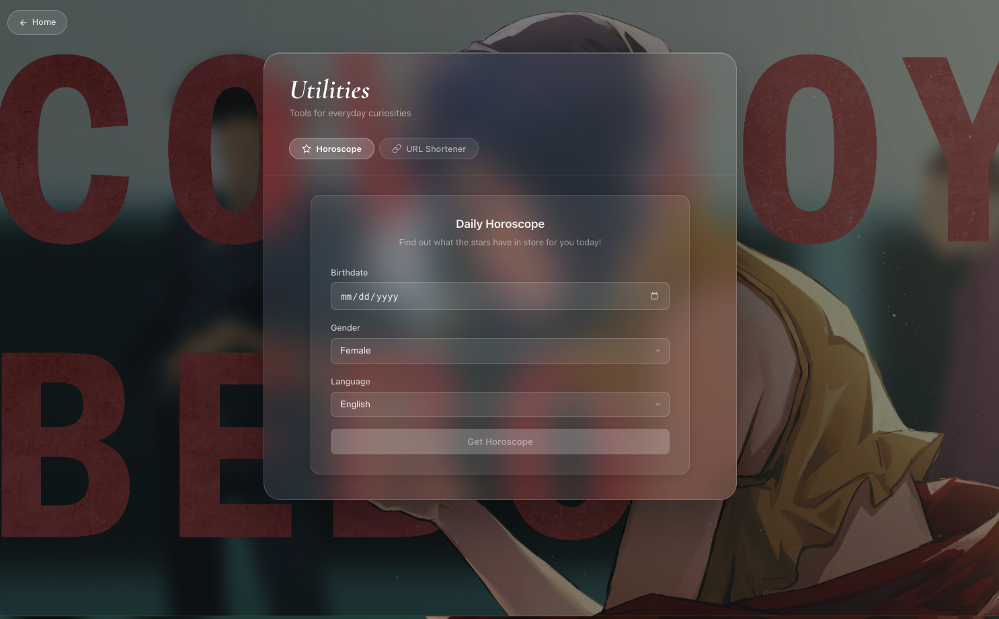
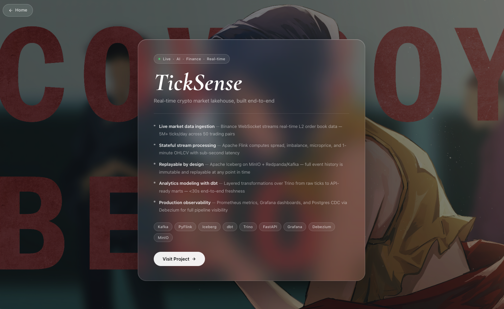

# Portfolio Website of Andrew Chen

[](https://github.com/AndrewAct/portfolio-website/actions/workflows/backend-ci.yml)

v0.1.0 

## Backend development

The FastAPI backend uses Python 3.11 and uv. Do not activate a virtual environment
manually; uv creates and manages `backend/.venv` from the committed lockfile.

```bash
cd backend
uv sync --all-groups
uv run uvicorn main:app --reload
```

Quality checks:

```bash
uv run pytest
uv run ruff check .
uv run ty check apps main.py
```

`uv run pytest` measures branch coverage for `backend/apps` and fails below 80%.

Testing note: `unittest.mock.AsyncMock` is both callable and awaitable. Setting
`AsyncMock(return_value="resend-msg-1")` means `await mock(...)` returns that value,
while the mock object itself still records how it was awaited. Use
`mock.await_args.kwargs` to inspect keyword arguments from the most recent await, and
`mock.await_args_list` to inspect every awaited call. The displayed `call(...)` entries
come from `unittest.mock.call`; they are call-record objects, not the mocked return value.

## Horoscope writing material

`backend/apps/services/horoscope/writing_material.py` contains 28 topics with four paired
Chinese/English scenes each, 12 writing approaches, sign-inspired editorial preferences,
and stock phrases to avoid. `ReadingAngle` in `prompting.py` means the writing brief:
one topic, one selected scene, and one approach. These are possibilities for the model
to develop, not facts about the reader.

Selection uses local, date-seeded random generators. Each sign draws seven topics without
replacement per Monday-Sunday week; its six preferred topics receive weight 2 and the
others weight 1. A boundary swap avoids repeating Sunday's topic on Monday. This favors
some material without confining any sign to a narrow set of topics. Different signs can
share a topic on the same day. Given the same catalog/code, sign and date, the selected
material stays the same across calls and languages; the model's final wording can vary.
No database, history lookup or extra model request is needed.

To inspect actual model output, run this from `backend/` with a configured API key
(it makes paid API calls; it does not start FastAPI):

```bash
PYTHONPATH=. uv run python scripts/eval_horoscope_prompt.py \
  --candidate openai:gpt-6.1-terra --reasoning-effort low --days 2 \
  --out /tmp/horoscope-eval.jsonl
```

The script checks structure, length, stock phrases and repetition. Read the raw samples
as well: those metrics cannot establish warmth, coherence or freedom from stereotyping.

## Production configuration

The backend image never contains credentials. On the server, keep the Compose file,
`nginx/`, and a private `backend.env` in the same directory:

```bash
cp backend.env.example backend.env
chmod 600 backend.env
docker compose up -d
```

After rotating a credential, update `backend.env` and recreate only the backend:

```bash
docker compose up -d --force-recreate --no-deps backend
```

`SUBSCRIPTION_TOKEN_SECRET` (signs the horoscope email confirm/preferences/unsubscribe
links) has no default and isn't a third-party credential — generate your own:

```bash
python3 -c "import secrets; print(secrets.token_urlsafe(48))"
```

Use a different value per environment (local `.env` vs. server `backend.env`); rotating it
invalidates every link that's already been emailed out.

### Short-link routing (`/r/<code>`)

The redirect lives on the backend (`GET /r/{short_url}`), so production nginx must forward
`/r/` to `backend:8000`. Without that rule, a short link falls through to the frontend, whose
nginx serves `index.html` for unknown paths with HTTP 200. Vue then renders its catch-all
`404 - Not Found` view, even though the short code exists and the backend is healthy.

Incident, 2026-11-09: copied short links showed that 404. It surfaced the day the server moved
to a static IP and DNS was updated, but the move was not the cause. The API lookup at
`/utilities/url_shortener/<code>` still answered in about 0.12 s (an unreachable MongoDB would
take the 5 s selection timeout), and the frontend calls `https://andrewcee.io`, not an IP. No
committed version of `nginx/nginx.conf` or `frontend-v2/nginx.conf` has routed `/r/`; both date
from the 2025-09-08 frontend rewrite, so links were probably broken since then, although the
exact start is unproven.

The fix was this block above `location /` in the server's mounted `nginx.conf`, followed by
`nginx -t` and `nginx -s reload`:

```nginx
location /r/ {
    proxy_pass http://backend:8000;
    proxy_set_header Host $host;
    proxy_set_header X-Real-IP $remote_addr;
    proxy_set_header X-Forwarded-For $proxy_add_x_forwarded_for;
    proxy_set_header X-Forwarded-Proto $scheme;
}
```

To verify, `curl -sI https://andrewcee.io/r/not-a-real-code` should return 404 with
`application/json` from the backend. A 200 with `text/html` means the rule is missing.

As of 2026-11-09 the rule exists only on the server. Add it to `nginx/nginx.conf` here before
the next deploy overwrites it. Separately, `UrlShortenerWidget.vue` uses the scheme-less
`shortened_url` as an `href`, so clicking a recent link in the widget resolves as a relative
path and still 404s; copying and pasting works.

### Server reboot and Compose notes

Incident, 2026-11-09: the first reboot in 731 days took the site down. A host `nginx` package
was still enabled at boot and took port 80, so `portfolio_nginx_1` failed to bind and showed
"Welcome to nginx!" to visitors with HTTP 200. After the host service was disabled, the container
crash-looped on `host not found in upstream "backend"` because the failed start had left it with
no network. `docker-compose down` then `up -d` restored it. Host `nginx` is now disabled.

- The server uses legacy `docker-compose` 1.29.2. Recreating an existing container fails with
  `KeyError: 'ContainerConfig'`, so after changing configuration run `docker-compose down`
  first. Never add `-v` unless you mean to delete volumes.
- After a reboot, expect four containers and check the page itself, not only the status code.
- The server compose file runs backend `0.1.14`, newer than the `0.1.3` tag in this repo.

## Observability

Both processes export OTLP metrics to Grafana Cloud: the API through FastAPI's native
telemetry (`OTEL_SERVICE_NAME=portfolio-api`), and the email worker through
`apps/monitoring/worker_metrics.py` (`portfolio-horoscope-worker`). AI metrics live in
`apps/monitoring/ai_generation.py` and are labeled with `ai_provider` / `ai_model` /
`ai_operation` / `outcome`:

| OTel name | Prometheus name | Meaning |
| --- | --- | --- |
| `portfolio.ai.generation.total` | `portfolio_ai_generation_total` | One per reading served: `success` or `fallback_*` (static template) |
| `portfolio.ai.generation.request.total` | `portfolio_ai_generation_request_total` | One per provider call; errors carry `error_type` (`402`, `429`, `TimeoutError`, ...) |
| `portfolio.ai.generation.request.duration` | `portfolio_ai_generation_request_duration_seconds_bucket` | Provider latency in seconds |

**Do not use `increase()` or `rate()` on these counters.** Traffic is a handful of events a
day, and each process gets a random `service.instance.id`, so every series is born already
at 1. `increase()` needs an earlier sample to diff against, so it reads that first event as
0. The dashboard showed 0 generations while Explore showed the series at 1. Count per series
instead: this is exact because a series never resets (one series per process):

```promql
sum(
  (last_over_time(portfolio_ai_generation_total{ai_operation="horoscope_generation"}[24h])
   - last_over_time(portfolio_ai_generation_total{ai_operation="horoscope_generation"}[5m] offset 24h))
  or last_over_time(portfolio_ai_generation_total{ai_operation="horoscope_generation"}[24h])
)
```

Apply the same pattern to the `_bucket` series inside `histogram_quantile` (rolling 24h p50/p95).
Alert rules using this pattern: `monitoring/grafana/horoscope-ai-alerts.yaml`.

The latency histogram declares second-scale buckets (`REQUEST_DURATION_BUCKETS_SECONDS`).
The SDK default buckets (`0, 5, 10, 25, …, 10000`) assume milliseconds. With them, every 3–5s call
landed in `(0, 5]` and p50/p95 always read exactly 2.5s / 4.75s.

Production `backend.env` still has `ENVIRONMENT=dev`, so series are labeled
`deployment_environment="dev"`. Don't filter dashboards on `production` until that changes.

* Homepage


* Utilities



* Projects 



### Memo 

In current stage of refactoring, when building backend Docker images, need to follow these steps:
1. Redirect to `/backend`
2. Run build command with the full path of the Dockerfile

    `docker build -f services/history/Dockerfile -t history_test:0.0.3 .`

If we can put all shared files in all services (config.py, logger.py...), we can bypass this step. 
However, this violates "DRY" principle.

I didn't find a better solution yet, so will stick with method for now.

**`horoscope_deliveries.id` vs `resend_message_id`** — two independent id spaces, not
derived from each other. `id` is our own sequential PK, assigned the moment a delivery is
claimed (before Resend is even called, status still `pending`). `resend_message_id` is a
separate id Resend generates and hands back only after a successful send — starts `NULL`,
stays `NULL` forever if the send fails before Resend accepts it. We store a copy of theirs
because their webhooks are correlated by *their* id, not ours: `get_delivery_by_resend_message_id()`
(backed by `ix_horoscope_deliveries_resend_message_id`) is the reverse lookup from an
incoming webhook event back to our row. That index is intentionally non-unique — a
collision across two different rows is judged unlikely, not proven impossible.

### Roadmap
- [ ] Horoscope subscription: let users edit their timezone (auto-detected via browser `Intl.DateTimeFormat`, no manual override exists yet in either the subscribe or preferences form)
- [x] OpenTelemetry metrics/traces to Grafana Cloud: HTTP, system/GC, AI generation dashboards and alerts (Nov 2026)
- [x] New feature: Project (TickSense.ai) (May 21, 2026)
- [x] Refactor frontend for better aesthetic (May 21, 2026)
- [x] New feature: Horoscope
- [x] Frontend: Support URL Shortener functionality 
- [x] Deploy on AWS Elastic Lightsail
- [x] Integrate GitHub Actions with lint, type-check, test, and coverage gates (July 2026)
- [x] Utilities and other functionalities
- [x] Backend backbone: uses FastAPI and Python (Expected: Nov 5, 2024)
- [x] Retrieve articles from Medium (https://andrewact.medium.com/) 
- [x] Frontend (raw): uses Angular and TypeScript (Expected: Nov 6, 2024)
- [x] Domain name service (andrewcee.io) (Expected: Nov 7, 2024)
